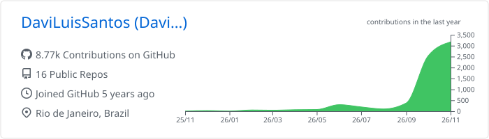
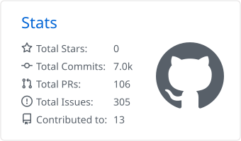
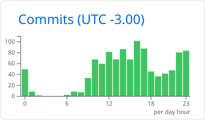
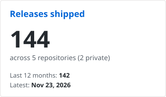
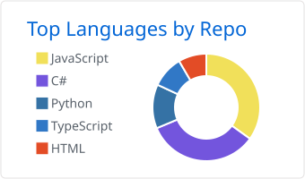
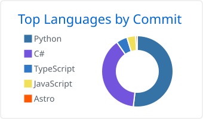

# Davi Luis

🇺🇸 English · [🇧🇷 Português](README.pt-BR.md)

**Backend software engineer from Rio de Janeiro. .NET (C#, ASP.NET Core, SQL) first, full stack with React and TypeScript when the product needs it. I modernize legacy systems without stopping the business that runs on them, and I connect devices to the cloud.**

> *Code is a way of thinking.* I try to write software the way I try to live: clearly, without shortcuts, and thinking about whoever comes next.

I own services end to end: design, tests, release, and the update that reaches the customer's machine. Most of that work runs far from the browser. A car pulls up to a gate, a camera reads the plate, and my code has a few hundred milliseconds to decide whether that gate opens, on a Windows server in a condominium where nobody is around to restart anything. That taught me to care about the boring parts: failure modes, tests, and updates that roll themselves back.

**Open to remote roles**, full-time or contract, back end or full stack .NET. Based in Brazil, working in US- and Europe-friendly hours.

[Portfolio](https://portfolio.daviluis.dev/en/?utm_source=github) · [LinkedIn](https://www.linkedin.com/in/davi-luis/) · [YouTube](https://www.youtube.com/channel/UCryhrvnlMcEfvisWyQurlyA) · [Instagram](https://www.instagram.com/davi.luissc/)

---

## In production at work

### 🚗 LPR vehicle access-control server · *20+ residential sites*
On-premise .NET server, built for Segmix, that decides in real time which vehicles may enter residential condominiums. I'm its main author.
- Integrates **cameras from four vendors, each with its own protocol** (Alphadigi over HTTP, binary TCP and JSON-RPC, Hikvision, Motorola, Intelbras) plus Control iD UHF readers, with a 20-year-old Firebird system. An architecture test keeps vendor code out of the core.
- **Fail-closed by design:** when in doubt, the gate stays shut. Authorized plates are also synced to each camera, so the gate keeps working if the server goes down.
- **Unattended updates:** blue-green on disk, SHA-256 checks, a maintenance window and automatic rollback if the health check fails. It also detects cameras that stopped sending events and reconfigures them.
- **2,000+ automated tests** (including contract tests against a real Firebird in Docker), a zero-warning release gate and **110+ releases**. The source is private; builds ship through a [public releases repo](https://github.com/DaviLuisSantos/AlphadigiServidorLPR-releases).

`.NET 10` `ASP.NET Core` `Firebird` `SQLite` `MediatR` `GitHub Actions`

### 🏢 Replacing a 20-year-old Delphi/Firebird system · *v1 in production since Sep 2026*
The concierge platform that takes over from the legacy system those condominiums have run on for two decades. Private, built with my team at Segmix.
- I lead the **domain design** of the new platform (.NET + React/Vite, installable as a PWA): identity, units, credentials, visits and vehicles. The second version has 4,300+ automated tests.
- Designed how its **three services** fit together: a versioned contract shipped as NuGet packages, tag-driven releases on GitHub Actions and a single installer that deploys them already wired to each other.
- The legacy keeps running while it is replaced: idempotent imports from Firebird, a persistent queue between services with leases and retry limits, and years of daily maintenance on the Delphi 2007 code that still pays the bills.
- Leading the migration of the personal access server from Delphi and WPF to ASP.NET Core.

`.NET 10` `ASP.NET Core` `EF Core` `React` `TypeScript` `SignalR` `Serilog` `NuGet`

---

## What I've built on my own

### 🎯 [Arco](https://github.com/DaviLuisSantos/arco) · *SaaS running on Azure, [arco.daviluis.dev](https://arco.daviluis.dev)*
A habit app where habits grow, with levels, goals in 6-week cycles and XP. I use it every day, and I use it to practice running a product the way I'd run one at work.
- .NET 10 Minimal APIs and React 19 in a single process, offline-first PWA with a check-in queue and Web Push. Multi-user with row-level isolation, Google sign-in, TOTP two-factor and revocable sessions.
- **CI/CD from scratch:** tests on every PR, Playwright end-to-end tests gating the deploy, Azure sign-in through OIDC and a managed identity. No long-lived secrets in the repo.
- Infrastructure in **Terraform** with Key Vault, **OpenTelemetry** into Application Insights, a transactional outbox, and retries with circuit breakers on outbound calls.
- An **MCP server with 32 tools** on top of its own REST API, so AI assistants can operate the app without duplicating business rules. 460+ tests, with the integration ones running against the real API.

`.NET 10` `React 19` `Azure App Service` `Terraform` `OpenTelemetry` `Playwright` `MCP`

### 🔐 [ControlId.Net](https://github.com/DaviLuisSantos/ControlId.Net) · *open source, on [NuGet](https://www.nuget.org/packages/ControlId.Net)*
The .NET library I wished existed when I started integrating Control iD access-control devices and REP time clocks.
- Covers the whole documented API of the access line (iDAccess, iDFlex, iDFace, iDBox, iDUHF), from users, faces and turnstiles to SIP intercom, RTSP streaming and network settings, with a test that fails if any documented section goes missing.
- Built for many devices at once: operations across a fleet with a result per device, paginated reads with `IAsyncEnumerable`, and a per-device concurrency limit, tuned on a real iDFace.
- Managed sessions with automatic re-login, Push mode for devices behind NAT, and ASP.NET Core endpoints to authorize access in real time.
- **220+ tests** on .NET 8 and .NET 10 (Linux) and .NET Framework 4.8 (Windows). Three NuGet packages published with Trusted Publishing (OIDC): no keys in the repo, and nothing ships unless every test passes.

`.NET 8` `.NET 10` `.NET Standard 2.0` `ASP.NET Core` `xUnit`

### 📹 Ocelo · *multi-vendor IP camera hub, private*
One hub between every system that needs video and the cameras, so cheap cameras and NVRs stop drowning in connections. Built solo and validated on real cameras.
- A .NET 10 control plane supervising MediaMTX. It records and streams live **without decoding video**, so it fits on a cheap machine: 128 simulated cameras recording used 43% of one core.
- The API is the product: OpenAPI, scoped keys per integration, HMAC-signed webhooks, server-sent events. The React interface uses only the public API.
- ONVIF (with a hand-written SOAP client), Hikvision and Dahua/Intelbras drivers. Sub-second live view over WebRTC, and event-based retention that used **68% less disk** on a real camera.
- 600 automated tests and a 7-day soak test on four real cameras, with what broke written down next to what held.

`.NET 10` `MediaMTX` `React` `TypeScript` `WebRTC` `ONVIF`

### 📊 [JobRadar](https://github.com/DaviLuisSantos/job-radar) · *in production on my own server*
Collects job listings every day from pluggable sources, ranks them against a profile with a score that explains itself, and tracks applications.
- Layered .NET 10: a pure domain, ports and adapters, and each job board as an integration that translates into one neutral model. A Blazor triage UI on top.
- **PostgreSQL or SQL Server behind one EF Core `DbContext`**, with per-provider migrations and 80 contract tests running against both real databases through Testcontainers.
- A rewrite of my Python prototype, checked to give the same scores on 5,388 real listings before it took over. Deploys itself when CI is green and rolls back by itself.

`.NET 10` `EF Core` `PostgreSQL` `SQL Server` `Blazor` `Docker` `Testcontainers`

### More
- **Remote MCP server for my notes** (private): a Python server that lets Claude and ChatGPT read and edit my Obsidian vault from any chat. GitHub OAuth limited to one login, every write is a Git commit that only confirms after the push, a versioned tool contract that fails the build when it drifts, and 750+ tests. Published through a Cloudflare Tunnel with no open port at home.
- **Emplaca** (private, *alpha*): my own Brazilian license plate recognition, with a detector and OCR trained in PyTorch and running natively in .NET via ONNX Runtime on the CPU. Running the detector only where each camera actually sees plates cut the time per frame by 37% with the same accuracy.
- **[CYD PC Dashboard](https://github.com/DaviLuisSantos/cyd-pc-dashboard)**: ESP32 firmware for a US$15 touchscreen that shows PC stats, service checks and market quotes, with over-the-air updates that roll back on their own. [Flash it from your browser](https://daviluissantos.github.io/cyd-pc-dashboard/).
- **Homelab**: a Debian server built from spare parts that runs JobRadar, the MCP server and about 25 containers, reachable only through Tailscale, with monitoring, alerts and tested offsite backups.
- **[Roteiro Manager](https://github.com/DaviLuisSantos/RoteiroManager)**: the Markdown editor and teleprompter I use to record my own videos.

---

## How I work

- **Assume things will fail.** Networks drop, cameras freeze, databases lock. I design for that first: fail-closed defaults, idempotent operations, retries with backoff, health checks, rollbacks.
- **Tests are what let me ship on a Friday.** Most of the code I care about runs where I can't reach it, so the test suite gates every release.
- **Boundaries keep code honest.** Vendor protocols, frameworks and databases stay at the edges, and I let architecture tests enforce it.
- **Think in systems, not only features.** I start from the real problem instead of the literal request, and I answer for the result: the design, the code and whether it actually made someone's work simpler.
- **AI with guardrails.** I work with Claude Code every day, with context files per area of the codebase and project rules that each have a test verifying them. The AI speeds up the typing. The architecture, the review and the responsibility stay with me.
- **Numbers over impressions.** I measure before I claim, and I say clearly what hasn't been measured yet.
- **Automate the release.** Tag, build, test, publish, update. If a human has to remember a step, it will eventually be skipped.

## Tools I reach for

- **Back end:** C# / .NET 8 and 10, ASP.NET Core, EF Core, REST APIs, MediatR / CQRS, SignalR, Node.js
- **Data:** PostgreSQL, SQL Server, Firebird, SQLite
- **Front end:** TypeScript, React, Next.js, Vite, Blazor, Tailwind CSS, PWA
- **Cloud & DevOps:** Azure (App Service, Key Vault, Application Insights), Terraform, Docker, GitHub Actions, OpenTelemetry
- **Testing:** xUnit, integration, contract and architecture tests, Testcontainers, Playwright
- **AI:** Claude Code, MCP servers (C# and Python), LLM APIs, PyTorch, ONNX Runtime
- **Devices & networking:** LPR cameras, Control iD, ONVIF, RTSP, TCP/IP, MikroTik, ESP32 (C++)
- **Legacy:** Delphi 2007, .NET Framework 4.8, WPF

## GitHub in numbers

<picture>
  <source media="(prefers-color-scheme: dark)" srcset="profile-summary-card-output/github_dark/0-profile-details.svg" />
  
</picture>

<picture>
  <source media="(prefers-color-scheme: dark)" srcset="profile-summary-card-output/github_dark/3-stats.svg" />
  
</picture>
<picture>
  <source media="(prefers-color-scheme: dark)" srcset="profile-summary-card-output/github_dark/4-productive-time.svg" />
  
</picture>

<picture>
  <source media="(prefers-color-scheme: dark)" srcset="profile-stats/releases-dark.svg" />
  
</picture>

<picture>
  <source media="(prefers-color-scheme: dark)" srcset="profile-summary-card-output/github_dark/1-repos-per-language.svg" />
  
</picture>
<picture>
  <source media="(prefers-color-scheme: dark)" srcset="profile-summary-card-output/github_dark/2-most-commit-language.svg" />
  
</picture>

<picture>
  <source media="(prefers-color-scheme: dark)" srcset="https://raw.githubusercontent.com/DaviLuisSantos/DaviLuisSantos/output/github-snake-dark.svg" />
  
</picture>

## Beyond the code

I have a degree in Systems Analysis and Development and a postgraduate diploma in Software Engineering, I'm finishing a bachelor's in Computer Science, and I'm **Microsoft Certified: Azure Fundamentals (AZ-900)**. Before software I installed and serviced air conditioning, which is why hardware and field work don't scare me. On my YouTube channel, **Davi Dev**, I show the projects I'm building, the tools I use and what I'm learning along the way.

[**Watch on YouTube →**](https://www.youtube.com/channel/UCryhrvnlMcEfvisWyQurlyA)
