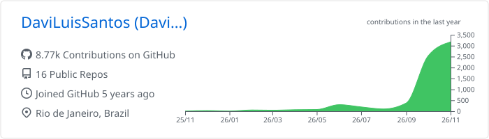
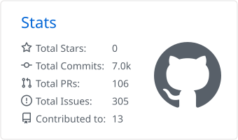
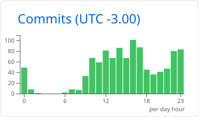
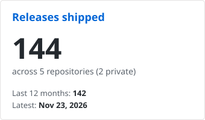
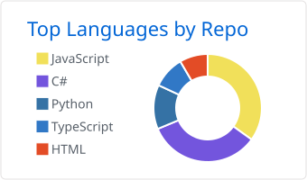
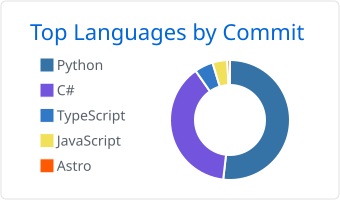

# Davi Luis

[🇺🇸 English](README.md) · 🇧🇷 Português

**Engenheiro de software backend do Rio de Janeiro. Primeiro .NET (C#, ASP.NET Core, SQL), full stack com React e TypeScript quando o produto pede. Modernizo sistemas legados sem parar o negócio que roda neles e ligo dispositivos à nuvem.**

> *Código é uma forma de pensar.* Escrevo software do jeito que tento viver: com clareza, sem atalhos e pensando em quem vem depois.

Sou dono dos serviços de ponta a ponta: desenho, testes, release e a atualização que chega na máquina do cliente. Boa parte desse trabalho roda longe do navegador. Um carro para no portão, a câmera lê a placa e o meu código tem algumas centenas de milissegundos para decidir se o portão abre, num servidor Windows de condomínio onde não tem ninguém por perto para reiniciar nada. Isso me ensinou a cuidar da parte chata: modos de falha, testes e atualizações que se desfazem sozinhas quando algo dá errado.

**Aberto a vagas remotas**, CLT ou contrato, de backend ou full stack .NET. Moro no Brasil e trabalho em horário compatível com os Estados Unidos e a Europa.

[Portfólio](https://portfolio.daviluis.dev/?utm_source=github) · [LinkedIn](https://www.linkedin.com/in/davi-luis/) · [YouTube](https://www.youtube.com/channel/UCryhrvnlMcEfvisWyQurlyA) · [Instagram](https://www.instagram.com/davi.luissc/)

---

## Em produção no trabalho

### 🚗 Servidor LPR de controle de acesso veicular · *mais de 20 condomínios*
Servidor .NET on-premise, feito para a Segmix, que decide em tempo real quais veículos podem entrar em condomínios residenciais. Sou o autor principal.
- Integra **câmeras de quatro fabricantes, cada uma com o seu protocolo** (Alphadigi por HTTP, TCP binário e JSON-RPC, Hikvision, Motorola, Intelbras) e antenas UHF da Control iD a um sistema Firebird de mais de 20 anos. Um teste de arquitetura mantém o código de fabricante fora do núcleo.
- **Fail-closed por padrão:** na dúvida, o portão fica fechado. As placas autorizadas também são sincronizadas em cada câmera, então o portão continua funcionando se o servidor cair.
- **Atualização sem supervisão:** blue-green em disco, conferência por SHA-256, janela de manutenção e rollback automático se o health check falhar. Também detecta câmera que parou de mandar evento e a reconfigura.
- **Mais de 2.000 testes automatizados** (com testes de contrato contra um Firebird real no Docker), portão de release com zero warnings e **mais de 110 releases**. O código é privado; os builds saem por um [repositório público de releases](https://github.com/DaviLuisSantos/AlphadigiServidorLPR-releases).

`.NET 10` `ASP.NET Core` `Firebird` `SQLite` `MediatR` `GitHub Actions`

### 🏢 Substituição de um sistema Delphi/Firebird de 20 anos · *v1 em produção desde set/2026*
A plataforma de portaria que assume o lugar do sistema legado em que esses condomínios rodam há duas décadas. Privada, feita com o meu time na Segmix.
- Lidero o **desenho de domínio** da nova plataforma (.NET + React/Vite, instalável como PWA): identidade, unidades, credenciais, visitas e veículos. A segunda versão tem mais de 4.300 testes automatizados.
- Desenhei como os **três serviços** se encaixam: contrato versionado em pacotes NuGet, release por tag no GitHub Actions e um instalador único que entrega os três já ligados entre si.
- O legado continua rodando enquanto é substituído: importação idempotente do Firebird, fila persistente entre serviços com lease e limite de tentativas, e anos de manutenção diária no código Delphi 2007 que ainda paga as contas.
- Lidero a migração do servidor de acesso pessoal de Delphi e WPF para ASP.NET Core.

`.NET 10` `ASP.NET Core` `EF Core` `React` `TypeScript` `SignalR` `Serilog` `NuGet`

---

## O que eu construí por conta própria

### 🎯 [Arco](https://github.com/DaviLuisSantos/arco) · *SaaS rodando no Azure, [arco.daviluis.dev](https://arco.daviluis.dev)*
Um app de hábitos em que os hábitos crescem, com níveis, objetivos em ciclos de 6 semanas e XP. Uso todo dia, e uso para praticar a operação de um produto como eu faria no trabalho.
- Minimal APIs em .NET 10 e React 19 num processo só, PWA offline-first com fila de check-ins e Web Push. Multiusuário com isolamento por linha, login com Google, dois fatores por TOTP e sessões revogáveis.
- **CI/CD do zero:** testes em todo PR, testes de ponta a ponta com Playwright como portão do deploy, login no Azure por OIDC com managed identity. Nenhum segredo de longa duração no repositório.
- Infraestrutura em **Terraform** com Key Vault, **OpenTelemetry** no Application Insights, transactional outbox e retry com circuit breaker nas chamadas externas.
- Um **servidor MCP com 32 ferramentas** em cima da própria API REST, para assistentes de IA operarem o app sem duplicar regra de negócio. Mais de 460 testes, com os de integração rodando contra a API real.

`.NET 10` `React 19` `Azure App Service` `Terraform` `OpenTelemetry` `Playwright` `MCP`

### 🔐 [ControlId.Net](https://github.com/DaviLuisSantos/ControlId.Net) · *open source, no [NuGet](https://www.nuget.org/packages/ControlId.Net)*
A biblioteca .NET que eu queria que existisse quando comecei a integrar equipamentos de acesso e relógios de ponto REP da Control iD.
- Cobre toda a API documentada da linha de acesso (iDAccess, iDFlex, iDFace, iDBox, iDUHF), de usuários, faces e catracas a interfonia SIP, streaming RTSP e configuração de rede, com um teste que falha se alguma seção documentada ficar de fora.
- Feita para muitos equipamentos ao mesmo tempo: operações em lote com um resultado por equipamento, leitura paginada com `IAsyncEnumerable` e limite de concorrência por equipamento, ajustado num iDFace real.
- Sessões gerenciadas com novo login automático, modo Push para equipamentos atrás de NAT e endpoints ASP.NET Core para autorizar acesso em tempo real.
- **Mais de 220 testes** em .NET 8 e .NET 10 (Linux) e .NET Framework 4.8 (Windows). Três pacotes NuGet publicados com Trusted Publishing (OIDC): sem chave no repositório, e nada sai se algum teste falhar.

`.NET 8` `.NET 10` `.NET Standard 2.0` `ASP.NET Core` `xUnit`

### 📹 Ocelo · *hub de câmeras IP multimarcas, privado*
Um hub entre todo sistema que precisa de vídeo e as câmeras, para câmera e NVR barato pararem de se afogar em conexões. Feito sozinho e validado em câmeras reais.
- Um plano de controle em .NET 10 supervisionando o MediaMTX. Grava e entrega ao vivo **sem decodificar vídeo**, então cabe em máquina barata: 128 câmeras simuladas gravando usaram 43% de um núcleo.
- A API é o produto: OpenAPI, chaves com escopo por integração, webhooks assinados com HMAC, eventos por SSE. A interface em React usa só a API pública.
- ONVIF (com cliente SOAP escrito à mão), Hikvision e Dahua/Intelbras. Ao vivo em menos de 1 segundo por WebRTC e retenção por evento que usou **68% menos disco** numa câmera real.
- 600 testes automatizados e um teste de 7 dias com quatro câmeras reais, com o que quebrou anotado ao lado do que aguentou.

`.NET 10` `MediaMTX` `React` `TypeScript` `WebRTC` `ONVIF`

### 📊 [JobRadar](https://github.com/DaviLuisSantos/job-radar) · *em produção no meu servidor*
Coleta vagas todo dia de fontes plugáveis, ordena cada uma contra um perfil com uma nota que se explica e acompanha as candidaturas.
- .NET 10 em camadas: domínio puro, portas e adaptadores, e cada site de vagas como uma integração que traduz para um modelo neutro. Interface de triagem em Blazor.
- **PostgreSQL ou SQL Server atrás de um único `DbContext` do EF Core**, com migrations por provedor e 80 testes de contrato rodando nos dois bancos reais com Testcontainers.
- Reescrita do meu protótipo em Python, conferida para dar as mesmas notas em 5.388 vagas reais antes de assumir. Faz o próprio deploy quando o CI está verde e volta de versão sozinho.

`.NET 10` `EF Core` `PostgreSQL` `SQL Server` `Blazor` `Docker` `Testcontainers`

### Outros
- **Servidor MCP remoto das minhas notas** (privado): um servidor Python que deixa o Claude e o ChatGPT lerem e editarem o meu vault do Obsidian de qualquer chat. OAuth do GitHub restrito a um login, cada escrita é um commit no Git que só confirma depois do push, contrato das ferramentas versionado que quebra o build se divergir e mais de 750 testes. Publicado por Cloudflare Tunnel, sem porta aberta em casa.
- **Emplaca** (privado, *alpha*): meu próprio reconhecimento de placas brasileiras, com detector e OCR treinados em PyTorch e rodando nativamente em .NET com ONNX Runtime na CPU. Rodar o detector só onde cada câmera realmente vê placa cortou o tempo por quadro em 37% com a mesma precisão.
- **[CYD PC Dashboard](https://github.com/DaviLuisSantos/cyd-pc-dashboard)**: firmware ESP32 para uma tela touch de US$ 15 que mostra dados do PC, checagem de serviços e cotações, com atualização pelo ar que se desfaz sozinha. [Grave pelo navegador](https://daviluissantos.github.io/cyd-pc-dashboard/).
- **Homelab**: um servidor Debian montado com peças que sobraram, rodando o JobRadar, o servidor MCP e cerca de 25 containers, acessível só pela Tailscale, com monitoramento, alertas e backup externo com restauração testada.
- **[Roteiro Manager](https://github.com/DaviLuisSantos/RoteiroManager)**: o editor de Markdown e teleprompter que uso para gravar os meus vídeos.

---

## Como eu trabalho

- **Parto do princípio de que vai dar errado.** A rede cai, a câmera trava, o banco dá lock. Projeto pensando nisso primeiro: padrão fail-closed, operações idempotentes, retry com backoff, health check, rollback.
- **Teste é o que me deixa fazer deploy na sexta.** A maior parte do código que importa roda onde eu não alcanço, então a suíte de testes é o portão de cada release.
- **Fronteiras mantêm o código honesto.** Protocolos de fabricante, frameworks e banco ficam nas bordas, e deixo testes de arquitetura garantirem isso.
- **Penso em sistemas, não só em features.** Parto do problema real em vez do pedido literal e respondo pelo resultado: o desenho, o código e se aquilo de fato simplificou o trabalho de alguém.
- **IA com controle.** Trabalho com o Claude Code todo dia, com arquivos de contexto por área do código e regras de projeto que têm, cada uma, um teste que as verifica. A IA acelera a digitação. A arquitetura, a revisão e a responsabilidade continuam comigo.
- **Números acima de impressões.** Meço antes de afirmar e deixo claro o que ainda não foi medido.
- **Release automatizado.** Tag, build, teste, publicação, atualização. Se depende de alguém lembrar um passo, uma hora esse passo é esquecido.

## Ferramentas que eu uso

- **Back end:** C# / .NET 8 e 10, ASP.NET Core, EF Core, APIs REST, MediatR / CQRS, SignalR, Node.js
- **Dados:** PostgreSQL, SQL Server, Firebird, SQLite
- **Front end:** TypeScript, React, Next.js, Vite, Blazor, Tailwind CSS, PWA
- **Cloud e DevOps:** Azure (App Service, Key Vault, Application Insights), Terraform, Docker, GitHub Actions, OpenTelemetry
- **Testes:** xUnit, testes de integração, de contrato e de arquitetura, Testcontainers, Playwright
- **IA:** Claude Code, servidores MCP (C# e Python), APIs de LLM, PyTorch, ONNX Runtime
- **Dispositivos e rede:** câmeras LPR, Control iD, ONVIF, RTSP, TCP/IP, MikroTik, ESP32 (C++)
- **Legado:** Delphi 2007, .NET Framework 4.8, WPF

## GitHub em números

<picture>
  <source media="(prefers-color-scheme: dark)" srcset="profile-summary-card-output/github_dark/0-profile-details.svg" />
  
</picture>

<picture>
  <source media="(prefers-color-scheme: dark)" srcset="profile-summary-card-output/github_dark/3-stats.svg" />
  
</picture>
<picture>
  <source media="(prefers-color-scheme: dark)" srcset="profile-summary-card-output/github_dark/4-productive-time.svg" />
  
</picture>

<picture>
  <source media="(prefers-color-scheme: dark)" srcset="profile-stats/releases-dark.svg" />
  
</picture>

<picture>
  <source media="(prefers-color-scheme: dark)" srcset="profile-summary-card-output/github_dark/1-repos-per-language.svg" />
  
</picture>
<picture>
  <source media="(prefers-color-scheme: dark)" srcset="profile-summary-card-output/github_dark/2-most-commit-language.svg" />
  
</picture>

<picture>
  <source media="(prefers-color-scheme: dark)" srcset="https://raw.githubusercontent.com/DaviLuisSantos/DaviLuisSantos/output/github-snake-dark.svg" />
  
</picture>

## Além do código

Sou formado em Análise e Desenvolvimento de Sistemas, tenho pós-graduação em Engenharia de Software, estou terminando o bacharelado em Ciência da Computação e tenho a certificação **Microsoft Certified: Azure Fundamentals (AZ-900)**. Antes do software, instalei e consertei ar-condicionado, por isso hardware e trabalho de campo não me assustam. No meu canal do YouTube, o **Davi Dev**, mostro os projetos que estou construindo, as ferramentas que uso e o que venho aprendendo no caminho.

[**Assistir no YouTube →**](https://www.youtube.com/channel/UCryhrvnlMcEfvisWyQurlyA)
