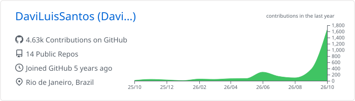
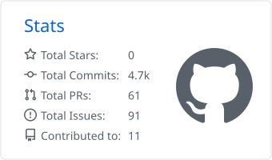
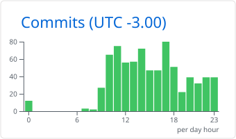
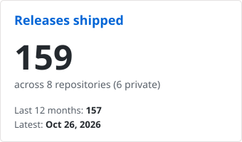
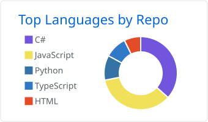
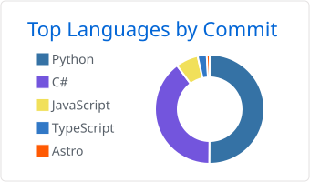

# Davi Luis

[🇺🇸 English](README.md) · 🇧🇷 Português

**Desenvolvedor full stack do Rio de Janeiro. Construo sistemas que rodam no mundo real, de APIs e aplicações web a integrações com hardware e visão computacional.**

> *Código é uma forma de pensar.* Escrevo software do jeito que tento viver: com clareza, sem atalhos e pensando em quem vem depois.

Boa parte do meu trabalho acontece longe do navegador. Um carro para no portão, a câmera lê a placa e o meu código tem algumas centenas de milissegundos para decidir se o portão abre. Meu dia a dia é com câmeras de leitura de placas, controladoras de acesso, bancos Firebird legados e servidores Windows em condomínios, onde não tem ninguém por perto para reiniciar nada. Isso me ensinou a cuidar da parte chata: modos de falha, testes e atualizações que se desfazem sozinhas quando algo dá errado.

[Portfólio](https://portifolio-daviluissantos-projects.vercel.app/) · [LinkedIn](https://www.linkedin.com/in/davi-luis/) · [YouTube](https://www.youtube.com/channel/UCryhrvnlMcEfvisWyQurlyA) · [Instagram](https://www.instagram.com/davi.luissc/)

---

## O que eu construí

### 🚗 Servidor LPR de controle de acesso veicular · *em produção*
Servidor .NET on-premise, feito para a Segmix, que decide em tempo real quais veículos podem entrar em condomínios residenciais.
- Integra **cinco fabricantes de câmeras, cada um com seu protocolo**: Alphadigi (HTTP, TCP binário, JSON-RPC), Hikvision, Motorola, Intelbras e antenas UHF Control iD. Um teste de arquitetura impede que código de fabricante vaze para o núcleo.
- **Fail-closed por design:** na dúvida, o portão fica fechado. As placas autorizadas também são sincronizadas em cada câmera, então o portão continua funcionando se o servidor cair.
- **Operação que se recupera sozinha:** detecta câmeras que pararam de enviar eventos e as reconfigura, e se atualiza numa janela de manutenção, com rollback automático se o health check falhar.
- **1.300+ testes automatizados** (incluindo testes de contrato contra um Firebird real no Docker) e **80+ releases**. O código é privado; os builds saem por um [repositório público de releases](https://github.com/DaviLuisSantos/AlphadigiServidorLPR-releases).

`.NET 10` `ASP.NET Core` `Firebird` `SQLite` `MediatR` `GitHub Actions`

### 🔐 [ControlId.Net](https://github.com/DaviLuisSantos/ControlId.Net) · *open source, no [NuGet](https://www.nuget.org/packages/ControlId.Net)*
A biblioteca .NET que eu queria que existisse quando comecei a integrar equipamentos de acesso e relógios de ponto REP da Control iD.
- Sessão gerenciada com re-login automático, modo Push para equipamentos atrás de NAT e endpoints ASP.NET Core para autorizar acessos em tempo real.
- Parser em streaming de arquivos AFD (Portaria 671/2021 e 1510/2009) que valida CRC-16 e não para de ler quando encontra linhas corrompidas.
- **144 testes** rodando em .NET 8 (Linux) e .NET Framework 4.8 (Windows), publicado com Trusted Publishing (OIDC): nenhuma chave no repositório, e nada é publicado se algum teste falhar.

`.NET 8` `.NET Standard 2.0` `ASP.NET Core` `xUnit`

### 📟 [CYD PC Dashboard](https://github.com/DaviLuisSantos/cyd-pc-dashboard) · *firmware ESP32*
Uma telinha touch de US$15 ao lado do monitor mostrando status do PC, processos, rede, cotações e estatísticas do YouTube. [Grave o firmware pelo navegador](https://daviluissantos.github.io/cyd-pc-dashboard/), sem instalar nada.
- Renderização sem flicker com sprites fora da tela, portal Wi-Fi de configuração no primeiro boot e interface em português e inglês.
- A parte divertida foi depurar o hardware: leituras SPI corrompidas porque a tela e o touch dividiam o mesmo periférico, e leituras do framebuffer deslocadas em um bit até eu baixar o clock de leitura para 6 MHz.

`C++` `ESP32` `PlatformIO` `Python` `GitHub Actions`

### Outros
- **[Arco](https://github.com/DaviLuisSantos/HabitSystem)** ([no ar](https://habit-system-front.vercel.app)): PWA de hábitos com pesos, check-ins parciais e nota de consistência. API .NET 9 em vertical slices, autenticação JWT, deploy contínuo no Azure e front em Next.js.
- **Emplaca** (privado, em desenvolvimento): o meu próprio reconhecimento de placas brasileiras, com detector e OCR treinados em PyTorch com dados sintéticos e rodando nativamente no .NET via ONNX Runtime.
- **[Job Tracker](https://github.com/DaviLuisSantos/job-tracker)**: coleta vagas em paralelo, dá uma nota de 0 a 100 para cada uma com regras que entendem negação (*"no C# required"* não conta como match), com uma etapa opcional de LLM (Gemini) para requisitos que as regras não pegam. Python, asyncio, Playwright, SQLite.
- **Pipeline de pesquisa para o YouTube** (privado): baixa e transcreve vídeos localmente com faster-whisper e usa LLMs para analisar as transcrições e extrair insights para o meu canal.
- **[Roteiro Manager](https://github.com/DaviLuisSantos/RoteiroManager)**: o editor de Markdown com teleprompter que eu uso para gravar meus próprios vídeos.

---

## Como eu trabalho

- **Parto do princípio de que vai dar errado.** A rede cai, a câmera trava, o banco dá lock. Projeto pensando nisso primeiro: padrão fail-closed, retry com backoff, health check, rollback.
- **Teste é o que me deixa fazer deploy na sexta.** A maior parte do código que importa roda onde eu não alcanço, então a suíte de testes é a minha rede de segurança.
- **Fronteiras mantêm o código honesto.** Protocolos de fabricante, frameworks e banco ficam nas bordas, e deixo testes de arquitetura garantirem isso.
- **Números acima de impressões.** Meço modelos em dados que eles nunca viram, mostro o que o limiar de confiança realmente entrega e deixo claro o que ainda não foi medido.
- **Release automatizado.** Tag, build, teste, publicação, atualização. Se depende de alguém lembrar um passo, uma hora esse passo é esquecido.

## Ferramentas que eu uso

- **Back end:** C# / .NET, ASP.NET Core, EF Core, MediatR, Node.js
- **Front end:** TypeScript, React, Next.js, Astro, Tailwind CSS
- **IA e visão computacional:** PyTorch, ONNX / ONNX Runtime, OpenCV, detecção de objetos e OCR, geração de dados sintéticos, Whisper (speech-to-text), APIs de LLM
- **Dados:** PostgreSQL, SQLite, Firebird
- **Cloud e DevOps:** Azure, Docker, GitHub Actions
- **Também:** Python, ESP32 / PlatformIO

## GitHub em números

<picture>
  <source media="(prefers-color-scheme: dark)" srcset="profile-summary-card-output/github_dark/0-profile-details.svg" />
  
</picture>

<picture>
  <source media="(prefers-color-scheme: dark)" srcset="profile-summary-card-output/github_dark/3-stats.svg" />
  
</picture>
<picture>
  <source media="(prefers-color-scheme: dark)" srcset="profile-summary-card-output/github_dark/4-productive-time.svg" />
  
</picture>

<picture>
  <source media="(prefers-color-scheme: dark)" srcset="profile-stats/releases-dark.svg" />
  
</picture>

<picture>
  <source media="(prefers-color-scheme: dark)" srcset="profile-summary-card-output/github_dark/1-repos-per-language.svg" />
  
</picture>
<picture>
  <source media="(prefers-color-scheme: dark)" srcset="profile-summary-card-output/github_dark/2-most-commit-language.svg" />
  
</picture>

<picture>
  <source media="(prefers-color-scheme: dark)" srcset="https://raw.githubusercontent.com/DaviLuisSantos/DaviLuisSantos/output/github-snake-dark.svg" />
  
</picture>

## Além do código

Sou formado em Análise e Desenvolvimento de Sistemas, curso Ciência da Computação e tenho a certificação **Microsoft Certified: Azure Fundamentals (AZ-900)**. No meu canal do YouTube, o **Davi Dev**, mostro os projetos que estou construindo, as ferramentas que uso e o que venho aprendendo no caminho.

[**Assistir no YouTube →**](https://www.youtube.com/channel/UCryhrvnlMcEfvisWyQurlyA)
